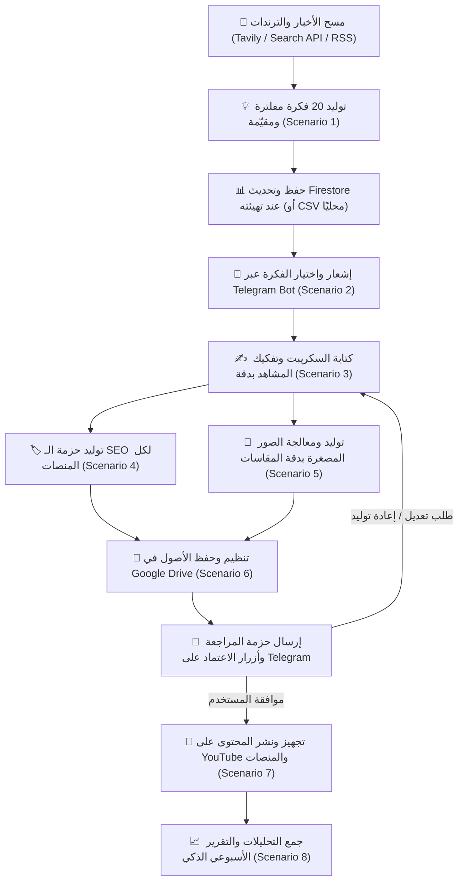

# 🚀 دليل تشغيل نظام مصنع المحتوى الذكي (AI Content Factory)

> **الإصدار:** 1.0.0 (نوفمبر 2026)
> **التطبيق الحالي:** FastAPI + واجهة ويب عربية، Google Gemini للمهام المهيأة، Firestore اختياري للبيانات، وCloudflare R2 اختياري للوسائط.
> **اللغة والنبرة:** اللهجة المصرية الراقية والمعاصرة للمحتوى التقني (Egyptian Tech Arabic)
---

> ملاحظة: يحتوي المستودع على ملفات وBlueprints تاريخية من خطة سابقة. لوحة الويب الحالية هي تطبيق FastAPI موضح تشغيله وربطه أدناه. لا تعني الملفات التاريخية أن تلك الخدمات مفعلة في الإنتاج.

## 📌 1. نظرة عامة على النظام (Architecture Overview)

نظام **AI Content Factory** هو منصة أوتوميشن متكاملة لإنتاج وتوزيع المحتوى التقني بالذكاء الاصطناعي من الألف إلى الياء. يقوم النظام بمسح أحدث الأخبار والترندات التقنية، توليد 20 فكرة فيديو مفلترة ومقيّمة مع منع التكرار، كتابة السكريبتات وتفكيك المشاهد، توليد الكلمات المفتاحية وأوصاف المنصات، توليد وتعديل أبعاد الصور المصغرة بمقاسات (1280×720 و 1080×1920) مع التحقق الهندسي، وإدارة الموافقات الكاملة عبر بوت تليجرام تفاعلي قبل النشر.



---

## 🗂️ 2. هيكل المشروع والملفات المنفذة (Project Structure)

```text
ai-content-factory/
├── blueprints/                 # ملفات سيناريوهات Make.com الجاهزة للاستيراد بنقرة واحدة
│   ├── scenario_1_idea_generator.json
│   ├── scenario_2_telegram_controller.json
│   ├── scenario_3_script_writer.json
│   ├── scenario_4_seo_generator.json
│   ├── scenario_5_thumbnail_generator.json
│   ├── scenario_6_storage_manager.json
│   ├── scenario_7_publishing_dispatcher.json
│   └── scenario_8_analytics_reporter.json
├── database/                   # بيانات CSV محلية أو Firestore
│   ├── AI_Content_Factory_Database.xlsx  # ملف الإكسيل الرئيسي (8 صفحات منسقة RTL)
│   ├── Ideas.csv
│   ├── Scripts.csv
│   ├── SEO.csv
│   ├── Thumbnails.csv
│   ├── Publishing.csv
│   ├── Analytics.csv
│   ├── Settings.csv
│   └── Sources.csv
├── prompts/                    # هندسة الأوامر والبرومبتس المنضبطة بـ JSON Strict
│   ├── system_persona.md
│   ├── 01_idea_generator_prompt.md
│   ├── 02_short_script_prompt.md
│   ├── 03_long_script_prompt.md
│   ├── 04_scene_breakdown_prompt.md
│   ├── 05_seo_generator_prompt.md
│   ├── 06_thumbnail_visual_prompt.md
│   └── 07_analytics_insights_prompt.md
├── core/                       # محرك التنفيذ البرمجي المحلي والأوتوميشن
│   ├── config.py
│   ├── idea_engine.py
│   ├── script_engine.py
│   ├── seo_engine.py
│   ├── thumbnail_engine.py
│   ├── storage_engine.py
│   ├── telegram_bot.py
│   ├── publishing_engine.py
│   └── analytics_engine.py
├── storage/                    # هيكل المجلدات المنظم محلياً وسحابياً (Google Drive)
│   └── AI Content Factory/2026/Video_ID/
│       ├── Research/
│       ├── Scripts/
│       ├── SEO/
│       ├── Thumbnails/
│       ├── Video_Assets/
│       └── Publishing/
├── tests/                      # حزمة الاختبارات الشاملة (13 معيار قبول)
│   └── run_pipeline_test.py
└── docs/                       # دليل التشغيل والتوثيق
    └── README.md
```

---

## ⚙️ 3. جداول قاعدة البيانات (Google Sheets Schema)

تحتوي قاعدة البيانات على **8 صفحات منسقة** تماماً:
1. **Ideas:** معرف الفكرة، العنوان، الملخص، الجمهور، الخطاف، زاوية المعالجة، النوع، المدة، الكلمات، درجات التقييم (Interest & Priority Score)، المصادر، الحالة.
2. **Scripts:** السكريبت المكتوب باللهجة المصرية، تفكيك المشاهد الـ 8، عدد الكلمات، زمن الإلقاء المحسوب.
3. **SEO:** 5 عناوين متباينة، أفضل عنوان، وصف يوتيوب الطويل، وصف ريلز القصير، 20 تاجز، 5 هاشتاجات، تعليق مثبت، أفكار فيديوهات مرتبطة.
4. **Thumbnails:** البرومبت، رابط الصورة الخام، رابط مقاس 1280×720 (يوتيوب)، رابط مقاس 1080×1920 (شورتس/تيك توك)، النص العربي، التحقق من الأبعاد.
5. **Publishing:** المنصة، تاريخ الجدولة، الرابط النهائي، وضع النشر، حالة موافقة المشرف، سجل العمليات.
6. **Analytics:** المشاهدات، الإعجابات، التعليقات، المشاركات، وقت المشاهدة، متوسط زمن المشاهدة (AVD)، نسبة النقر (CTR)، تقييم خوارزمية AI.
7. **Settings:** إعدادات النيش، الجمهور، الدولة، ألوان الهوية (`#0F172A`, `#38BDF8`, `#818CF8`)، معرفات تليجرام المصرح لها.
8. **Sources:** مصادر الأخبار والترندات التقنية الموثوقة (OpenAI, DeepMind, Hugging Face, TechCrunch, Product Hunt).

---

## 🤖 4. أوامر بوت تليجرام (Telegram Control Center)

| الأمر | الوظيفة البرمجية |
|---|---|
| `/start` | عرض القائمة الرئيسية وأزرار التحكم السريعة |
| `/ideas` | توليد أو استعراض أحدث الأفكار المتاحة للاختيار |
| `/shorts` | فلترة أفكار الشورتس والريلز فقط مع أزرار التنفيذ |
| `/long` | فلترة أفكار الفيديوهات الطويلة (8-12 دقيقة) |
| `/generate [ID]` | بدء إنتاج حزمة الفيديو فوراً للفكرة المحددة |
| `/status` | عرض حالة العمليات الجارية وخط الإنتاج |
| `/history` | عرض المحتوى السابق وسجل العمليات |
| `/settings` | استعراض وتعديل الإعدادات والنيش |
| `/help` | عرض دليل المساعدة السريعة |

---

## 🛠️ 5. خطوات التثبيت والربط السحابي (Cloud & Local Setup)

### بناء ملفات CSS للوحة التحكم
بعد تثبيت Node.js، نفّذ `npm install` ثم `npm run build:css` لتجميع Tailwind محلياً في `web/static/css/tailwind.css` قبل النشر. لا تعتمد الواجهة في الإنتاج على Tailwind CDN.

### إعداد Google Gemini وVoxArabicStudio
تم ربط تدفق الصوت بمحرك VoxArabicStudio مع Google Gemini TTS. يختار النظام صوتاً مناسباً: Puck للشورتس وCharon للفيديوهات الطويلة، ويمكن اختيار أصوات Gemini الأخرى أو الرجوع إلى Edge TTS. يُحفظ صوت Gemini بصيغة WAV ويُستخدم الملف نفسه عند رندر الفيديو.

ضع `GEMINI_API_KEY` في متغيرات بيئة الخادم (ولا تضعه في ملفات الواجهة أو قاعدة CSV). النموذج الافتراضي هو `gemini-2.5-flash-preview-tts` ويمكن تغييره عبر `GOOGLE_TTS_MODEL`. يحتاج استخدام API إلى مفتاح Google AI Studio، وقد تنطبق حدود الاستخدام أو الرسوم وفق حساب Google.

على Vercel، أضف `GEMINI_API_KEY` إلى متغيرات بيئة **Production** و**Preview** من إعدادات المشروع، ثم أعد النشر. إذا لم يكن المفتاح موجوداً، يعيد مسار الإنتاج `503` برسالة إعداد مباشرة. اتبع [دليل Firestore وR2 وقفل الدخول](docs/cloud-setup-ar.md) لتفعيل التخزين الدائم وحماية لوحة التحكم.

لجعل توليد الصور يستخدم Google Imagen بدلاً من مزود الصور الحالي، اضبط `GOOGLE_USE_IMAGEN=true` و(اختيارياً) `GOOGLE_IMAGE_MODEL`. قد يتطلب Imagen تفعيل الفوترة والصلاحيات في Google Cloud بحسب توفر الخدمة للحساب والمنطقة. يظل توليد النصوص والصور والصوت وحدات مستقلة؛ إعداد TTS لا يحول تلقائياً كل مهام الذكاء الاصطناعي إلى Google.

### ملاحق تاريخية: Blueprints Make.com
الخطوات التالية تخص ملفات التكامل القديمة في المستودع. ليست مطلوبة لتشغيل لوحة الويب الحالية، وبعضها غير مرتبط بكود التطبيق.

### الخطوة 1: استيراد سيناريوهات Make.com
1. سجل الدخول إلى حسابك على [Make.com](https://www.make.com/).
2. أنشئ سيناريو جديد (Create a new scenario).
3. اضغط على أيقونة الخيارات الثلاثية `...` في الأسفل واختر **Import Blueprint**.
4. اختر ملف السيناريو من مجلد `blueprints/` (مثال: `scenario_1_idea_generator.json`).
5. كرر الخطوة لكل السيناريوهات المطلوبة.

### الخطوة 2: ربط الاتصالات (Connections Setup)
- **OpenAI Connection:** أدخل `OPENAI_API_KEY` في موديول OpenAI.
- **Firestore / R2:** اتبع الخطوات في `docs/cloud-setup-ar.md`؛ هذان موصلا التخزين للتطبيق الحالي.
- **Telegram Bot Connection:** أنشئ بوتاً عبر `@BotFather`، انسخ الـ Token، واضبط الـ Webhook.
- **اختياري لخدمات الصور:** أضف `Cloud Name`, `API Key`, `API Secret` لضبط التحجيم التلقائي.
- **YouTube Connection:** اربط قناتك عبر OAuth2 لمنح صلاحيات النشر غير المدرج أو المجدول.

### الخطوة 3: تشغيل لوحة التحكم وموقع القيادة (Web Command Center)
تم بناء لوحة تحكم تفاعلية متكاملة بالـ FastAPI والـ Tailwind CSS:
```powershell
# تشغيل خادم لوحة التحكم:
python run_dashboard.py
# ثم فتح الرابط في المتصفح:
# http://127.0.0.1:8000
```
- **غرفة القيادة (Dashboard):** مؤشرات أداء حية (KPIs) ومخطط خط الإنتاج الذكي.
- **بنك الأفكار (Idea Bank):** بحث وفلترة واستعراض وتوليد 20 فكرة جديدة بنقرة واحدة.
- **استوديو الإنتاج (Studio):** فحص كامل للسكريبت المصري، تفكيك المشاهد الـ 8، حزمة الـ SEO، واستعراض الصور المصغرة بدقة (1280x720 و 1080x1920).
- **بوابة الاعتماد (Publishing Gate):** إدارة موافقة النشر للمنصات الخمس.
- **تحليلات النمو (Growth Analytics):** رسوم بيانية تفاعلية (Chart.js) وتقرير أسبوعي جاهز للنسخ لتليجرام.

### الخطوة 4: التشغيل المحلي واختبار الجودة الشامل
ملاحظة: تعليمات الاختبار والنتائج التالية وصف تاريخي من النسخة السابقة، وليست شهادة جودة أو إثباتًا بأن كل التكاملات تعمل في النشر الحالي.
```powershell
# تفعيل البيئة وتشغيل فحص الجودة الشامل:
.\.venv\Scripts\Activate.ps1
python tests/run_pipeline_test.py
```

---

## 📊 6. تقرير نتائج الاختبارات (Test Verification Summary)

| رقم المعيار | الفحص | النتيجة |
|---|---|---|
| 1 | استقبال بيانات النيش والإعدادات الافتراضية | ✅ ناجح |
| 2 | توليد 20 فكرة فريدة وغير مكررة مع التقييم | ✅ ناجح |
| 3 | حفظ وتحديث الأفكار في Google Sheets و Excel | ✅ ناجح |
| 4 | اختيار فكرة وتمرير المعرف عبر Telegram Bot | ✅ ناجح |
| 5 | كتابة السكريبت المصري وتفكيك المشاهد الـ 8 | ✅ ناجح |
| 6 | توليد باقة الـ SEO الكاملة (5 عناوين + 20 تاجز + تعليق) | ✅ ناجح |
| 7 | توليد الصورة المصغرة السينمائية فعلياً | ✅ ناجح |
| 8 | التحقق الهندسي من أبعاد الصور (1280×720 و 1080×1920) | ✅ ناجح |
| 9 | إنشاء هيكل المجلدات الستة وتخزين الأصول | ✅ ناجح |
| 10 | إرسال بطاقة التسليم مع أزرار تفاعلية لتليجرام | ✅ ناجح |
| 11 | بوابة الأمان: حظر النشر التلقائي بدون موافقة صريحة | ✅ ناجح |
| 12 | تجهيز حزم النشر للمنصات الخمس المدعومة | ✅ ناجح |
| 13 | تسجيل البيانات وتحليل أداء المحتوى والتقرير الأسبوعي | ✅ ناجح |

**ملاحظة الحالة:** وصف الاختبارات أعلاه يعكس وثائق سابقة ولا يُعد ضمانًا لحالة النشر الحالية أو لتكاملات حسابات المنصات. بعض الوصلات المذكورة اختيارية أو غير مكتملة. راجع تقرير المراجعة في هذا الفرع وتعليمات [إعداد السحابة](docs/cloud-setup-ar.md)، ولا تعرض تحليلات على أنها حقيقية قبل ربط مصدرها.
